# Code guide

Read this when you want to understand the implementation, not the product story. The product story is in [project-guide.md](project-guide.md). How the two models and the tool loop work is in [ai-guide.md](ai-guide.md). Trust rules are in [architecture.md](architecture.md).

The numbered sections follow one chat message through the files. Open the named function while you read. Model choices (RAG, two models, the tool loop) stay in the AI guide so they are not repeated here.

## The decisions

One chat turn is not “the model answers.” The server does this:

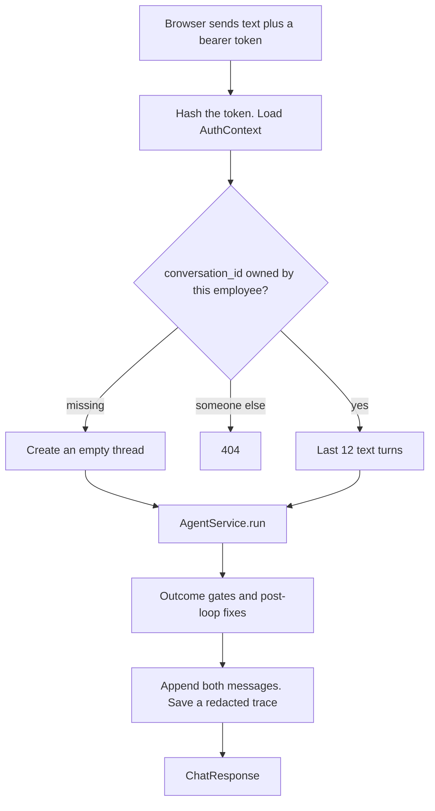

Leave is two rows, not one. `prepare_leave_request` writes `action_proposals`. A confirm writes `leave_requests` with status `pending_manager_review`. Nothing in this app sets `approved`.

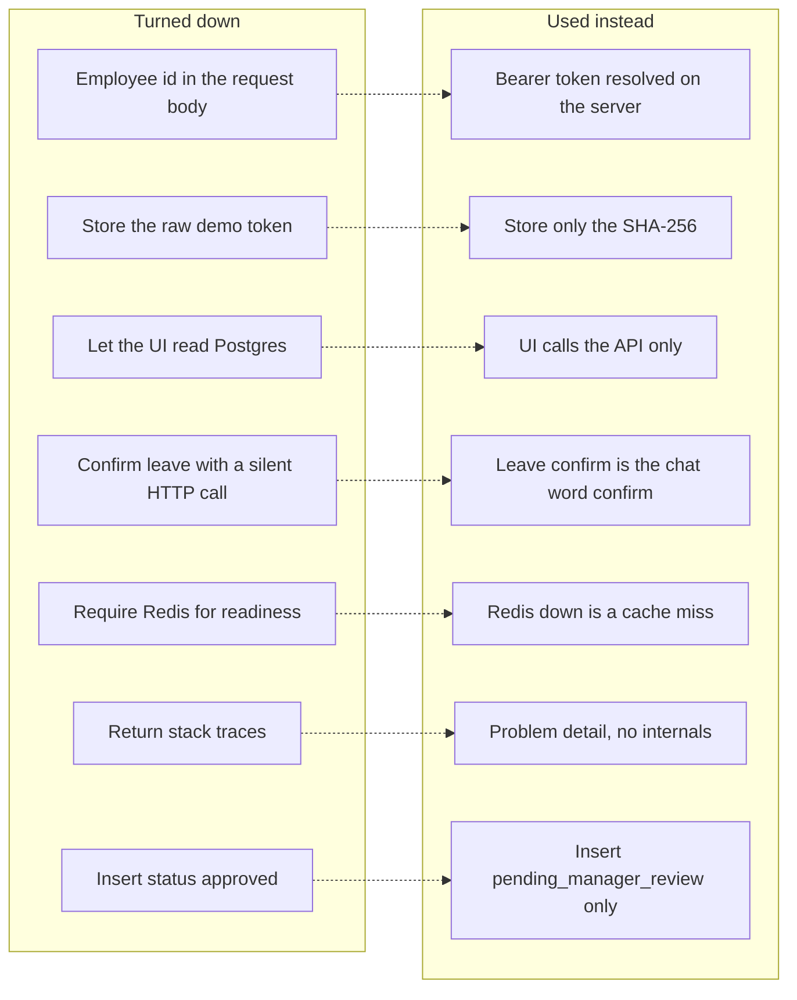

| Decision | Why this | What it refuses |
| --- | --- | --- |
| The browser sends a bearer token, never an employee id | The client can be told to lie. `require_auth` hashes the token and loads the row. Tools receive that `AuthContext`. | A body field `employee_id` would let the page choose whose balance to read. |
| Store the SHA-256, not `token-alya` | A database dump should not be a list of passwords. `token_hash` in `src/security.py` is what `employees.token_hash` holds. | The raw token in the table is the credential. |
| The demo password stays in the login page | `web/lib/demo-accounts.ts` only decides which bearer token to store. The API contract is that token. | A password endpoint would be a second secret the API must keep. |
| `fake` and `live` are wired in `build_runtime` | Tests hit the same routes with `MemoryRepository`, `NullCache`, and `DeterministicProvider`. | One path that always calls OpenAI makes `pytest` cost money and flake. |
| `/healthz` is liveness. `/readyz` is dependencies | A process can be up while the policy index is empty. Ready requires database, model config, and chunks. | A single “ok” hides “not seeded”. |
| Redis down is `cache: degraded`, and the API can still be ready | Search becomes a miss. Balances and leave rows are in Postgres. | Making Redis required turns a cache outage into an outage of the assistant. |
| Leave confirm is the word “confirm” in the thread | The button should show up in the transcript and get an agent reply. `confirmFromChat` calls `sendMessage("confirm")`. | A silent confirm would change the database and leave the thread looking untouched. |
| Ticket confirm is a direct POST | The button already has the proposal id. It reloads the thread after `POST /api/v1/ticket-proposals/{id}/confirm`. | Sending the ticket through the model makes “open” depend on the model noticing. |
| Empty New Chat is not inserted | A row appears on the first message. The sidebar lists threads that already have messages. | Creating a row on New Chat fills history with blank conversations. |
| Another employee’s conversation id is 404 | `ConversationNotFound` does not reveal that the id exists. | 403 tells the caller the thread is real. |
| Gates run after the model returns | The prompt can be ignored. The outcome is a branch in `AgentService.run`. | Trusting the last sentence lets a fake citation or another person’s name through. |
| Exactly four outcomes | The badge and the evaluation report need a closed set: `answered`, `action_proposed`, `escalated`, `abstained`. | A free-form status cannot be a release gate. |
| Domain code never calls the model | `validate_leave_request` must fail the same way on every run. | “Ask the model if these dates are legal” is not a hard gate. |
| Weekdays only | Public holidays are not configured. Monday–Friday is explicit and testable. | Guessing a holiday list would refuse real working days. |
| Seed without `--reset` keeps rows | A retry or a demo replay must not delete the proposal you just confirmed. | Reset on every start wipes the data you are showing. |
| `SELECT … FOR UPDATE` in one transaction | Two confirms at the same moment must not insert two leave rows. | Check-then-insert without a lock races. |
| The status check allows `approved` | Historical seed rows use that word. This app’s insert always writes `pending_manager_review`. | Deleting `approved` from the check would reject the fixture. Adding an approve path would close HR’s job. |
| Errors are problem detail | The client gets a title, status, and a short detail. No stack, query, or token. | `str(exc)` from the driver leaks internals. |
| Evaluation is a release gate, not leave approval | GO means the assistant passed the cases. A human still approves leave. | A fast HTTP 200 with a worse recall is not a release. |
| Hard gates are 100%. Other metrics are at least 80% | One cross-user read fails the product. One soft miss is quality. | Averaging them hides the unsafe case. |
| Overlap is a unit test | The rule is deterministic and must not spend a model call. | A live case would mix wording into a database rule. |
| The UI never reads Postgres | Next.js calls HTTP. Auth and confirm stay on the server. | A browser query skips both. |

## 1. Process start — `src/api.py`

`create_app()` builds the FastAPI app. `build_runtime()` chooses the pieces:

| `MODEL_MODE` | Database | Cache | Model |
| --- | --- | --- | --- |
| `fake` | `MemoryRepository` (tests) | `NullCache` | `DeterministicProvider` |
| `live` (default) | `PostgresRepository` | `ResilientCache` if `REDIS_URL` is set, else `NullCache` | `OpenAIProvider` |

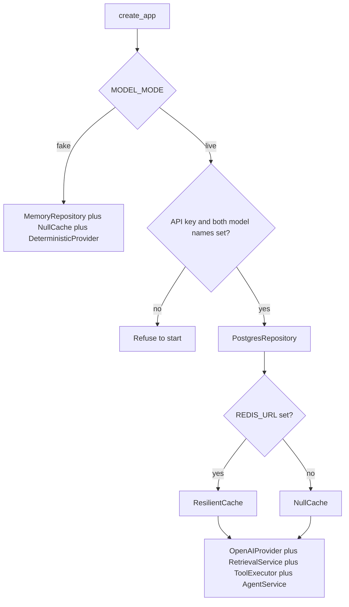

Live mode refuses to start unless `OPENAI_API_KEY`, `AGENT_MODEL`, and `EMBEDDING_MODEL` are set (`Settings.live_model_ready` in `src/config.py`). Those objects sit on `app.state`. Retrieval and tools are created inside `build_runtime` and held by the agent.

`GET /healthz` only means the process is up. `GET /readyz` checks database, cache, model config, and whether policy chunks exist. A dead Redis is `cache: degraded`. The API can still be `ready`, because Redis is not the source of truth.

Why the split: a load balancer needs “the process answers”. A demo needs “the index and the database are actually there”. Those are different questions.

## 2. Who is speaking — `require_auth`

Every `/api/v1/` route uses `require_auth` in `src/api.py`.

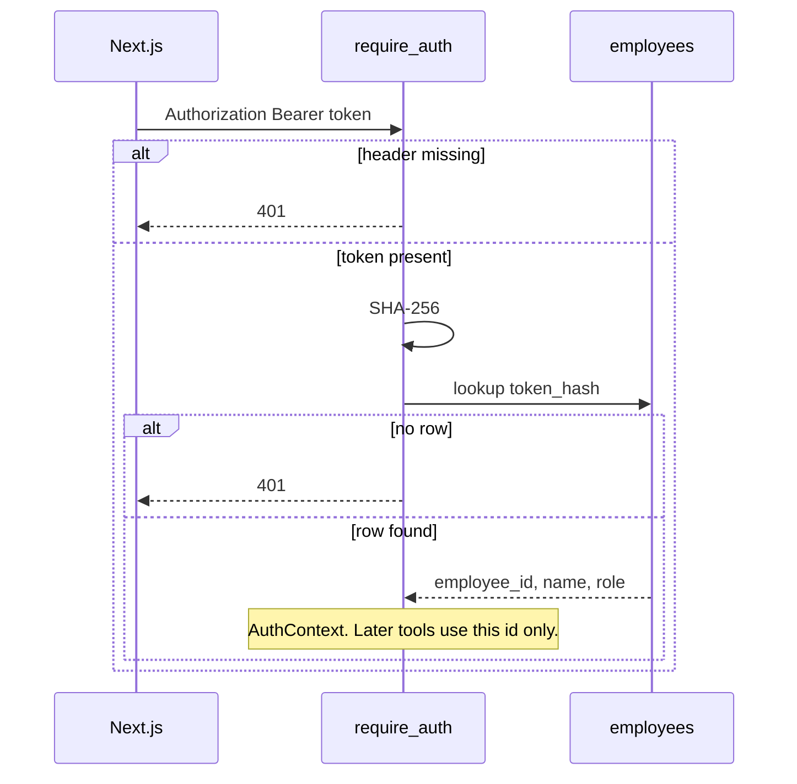

Demo passwords live only in `web/lib/demo-accounts.ts`. The API never sees the password. After login the browser stores the demo bearer token and sends it on each call.

Why 401 for both a missing header and an unknown hash: the client should not learn which of the two failed in a way that helps guessing. The detail strings differ (“Missing or invalid” versus “Invalid”), and that is the whole distinction.

## 3. The browser — `web/components/chat-thread.tsx`

`ChatThread` is the threaded UI.

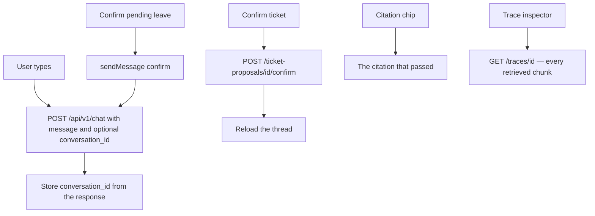

`sendMessage` posts `{ message, conversation_id? }` to `POST /api/v1/chat` (`web/lib/api.ts`). The first message of a new chat omits `conversation_id`. The response includes one, and the UI keeps it for the next turn.

The leave **Confirm** button does not call the confirm endpoint. `confirmFromChat` sends the user message `"confirm"`. The ticket button is `confirmTicketProposal`, which calls the ticket confirm URL, then reloads the thread.

The trace inspector (`web/components/trace-inspector.tsx`) loads `GET /api/v1/traces/{trace_id}`. The chip under the bubble is the citation the answer was allowed to keep. The inspector list is every chunk retrieved on that run.

Empty “New Chat” is only local state. A Postgres conversation row appears when the first message is sent. Sidebar history lists threads that already have messages.

Why the two buttons differ: leave confirm had to appear as a line in the chat. The ticket button already holds a proposal id, so it does not need the model to choose the tool.

## 4. One turn — `AgentService.run` in `src/agent.py`

This function is long because the safety checks sit after the model, not inside the prompt. The model loop itself is drawn in [ai-guide.md](ai-guide.md).

### Bind the thread

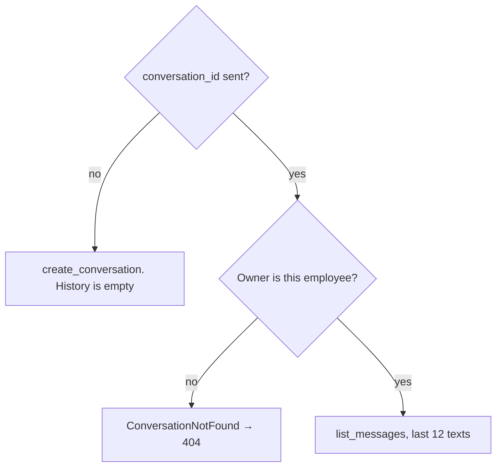

Stored history is user and assistant **text** only (`ThreadMessageView` says tool payloads are not kept). The model sees up to 12 previous texts plus the new message. It does not see old tool JSON. Why: a tool result from an earlier turn is not evidence for this turn, and resending it spends tokens.

### Instructions sent every model call

`SYSTEM_INSTRUCTIONS` is process rules: search first, do not invent dates, match the user’s language, never approve. It is not a copy of the HR numbers. Each call also appends:

- `calendar_brief(today)` from `src/calendar.py` (Asia/Jakarta: today, this Friday, next week).
- The earliest annual start date from `add_business_days(today, 3)`.
- A pending leave or ticket proposal, if this employee still has one.

That block is input tokens on every model call in the loop. Why those three are rebuilt: the date changes at midnight, and a pending proposal must be visible or the model will not know what “confirm” refers to.

### The loop

Defaults in `src/config.py`: at most **4** model turns and **6** tool calls.

```mermaid
flowchart TD
  call[provider.respond] --> shape{Tool calls?}
  shape -->|yes| exec[ToolExecutor.execute]
  exec --> prep{prepare_leave_request?}
  prep -->|no date or duration| err[DomainError. No proposal]
  prep -->|reason the user never typed| nullreason[Force reason null]
  prep -->|otherwise| runtool[Run the tool]
  err --> append[Append function_call_output]
  nullreason --> runtool
  runtool --> append
  append --> call
  shape -->|plain text| gates[Outcome gates]
```

`OpenAIProvider.respond` (`src/providers.py`) calls the Responses API with `store=False`. Tool results are fed back as `function_call_output`. The provider does not touch Postgres. While a tool runs, `run` records a `kind: model` or `kind: tool` step. `search_hr_policy` results are kept in `retrieved_chunks` (every chunk) and `retrieved_by_document` (one row per document id, used for citations).

Before `prepare_leave_request` is allowed to run, the loop checks the conversation text:

- no date words → `DomainError` (do not invent a start date)
- no duration → `DomainError` (a start date is not “1 day”)
- a reason the user never typed → the argument is forced to `null`

Those errors become tool `status: error`. They do not create a proposal.

Why block prepare before domain validation: a start date is not “1 day”, and a reason the user never typed must not be stored.

### After the model stops

The first matching branch sets `outcome` and sometimes replaces `answer`:

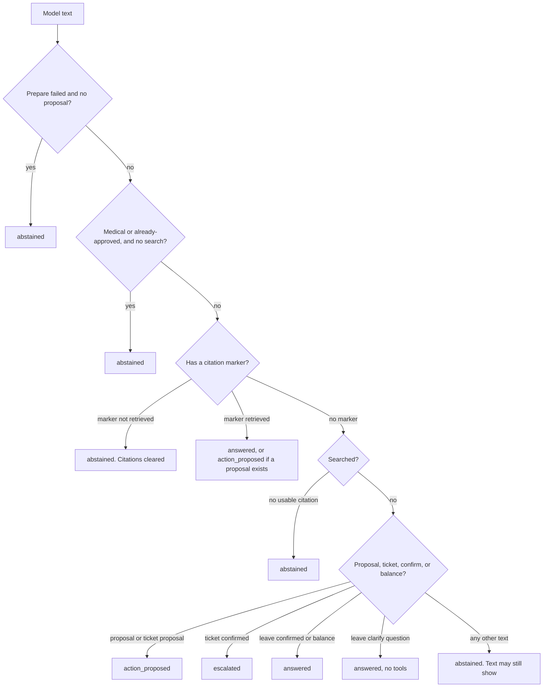

The same branches as a list. The first match wins:

| Condition | Outcome |
| --- | --- |
| Prepare tool failed and there is no proposal | `abstained`, explain the domain error |
| Medical or “is this already approved?” question with no policy search | `abstained` |
| A `[HR-…]` marker is not in this run’s retrieved documents | `abstained`, citations cleared |
| Valid markers | `answered`, or `action_proposed` if a proposal exists |
| Searched but no usable citation | `abstained` |
| Proposal or ticket proposal created | `action_proposed` |
| Ticket confirmed | `escalated` |
| Leave confirmed | `answered` (status text is `pending_manager_review`) |
| Balance tool ran and the answer is non-empty | `answered` |
| Leave intake and the model asked a clarifying question | `answered` with no tools |
| Any other free-form text | `abstained` (the text may still be shown; it is not a grounded policy answer) |

`Outcome` in `src/contracts.py` has exactly four values: `answered`, `action_proposed`, `escalated`, `abstained`. Why a closed set: the badge, the stored `outcome` column, and `_score_case` all compare against it.

### Fixes that run even when the model “finished”

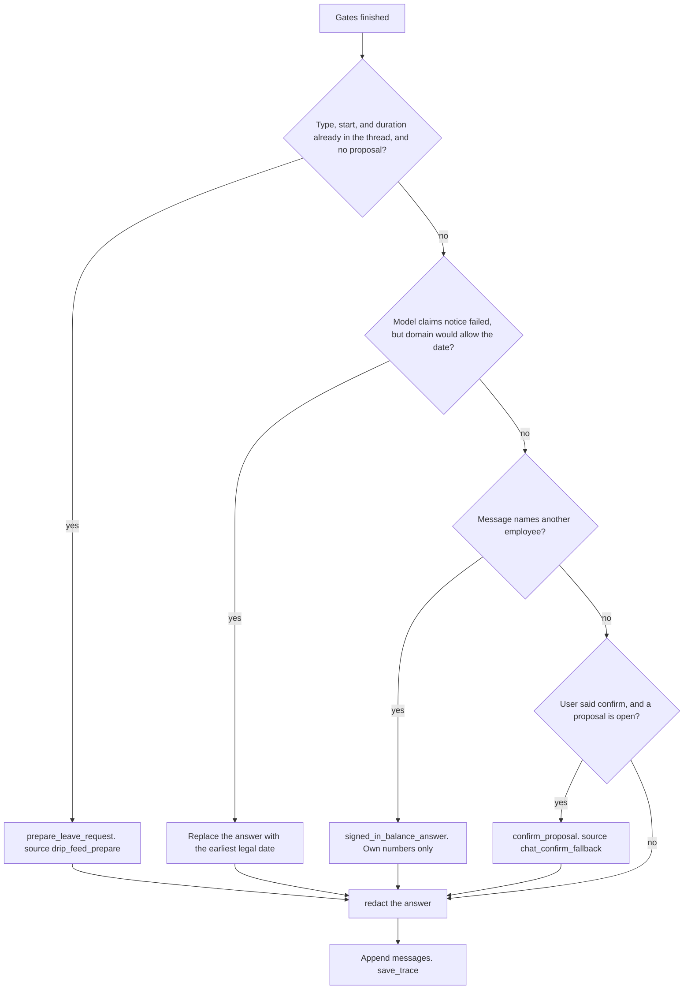

These blocks are why a second message sometimes does not match the model’s last sentence.

- **Drip-feed prepare.** If the conversation already has a leave type, a start date, and a duration (“4”, “2 days”) but the model did not call prepare, `run` calls `prepare_leave_request` itself. Waiting for the model drops the proposal. Trace: `source: drip_feed_prepare`.
- **Notice the model invented.** Domain is the notice rule. The model does not get to fail a date domain would accept.
- **Other employee’s balance.** The tool never loaded the other row. The prose must not pretend it did.
- **Chat confirm fallback.** “confirm”, “yes”, “ya”, “setuju” with an open proposal still confirms if the model skipped the tool. Trace: `chat_confirm_fallback`. A pending ticket uses the same idea when no leave proposal is open.
- **`redact()`** (`src/security.py`) drops email, phone, `token-…`, and personal medical phrases such as “diabetes” before the answer is stored.

Then both messages are appended, and `save_trace` writes the step list, model names, retrieved chunks, citations, token counts, and a redacted error if the provider threw.

## 5. Tools — `src/tools.py`

`TOOL_SCHEMAS` is the only tool list the model sees. `ToolExecutor.execute` is the only implementation. Unknown names raise `DomainError`.

| Tool | Reads / writes | Identity |
| --- | --- | --- |
| `search_hr_policy(query, top_k)` | Read chunks. May write the Redis cache. | None |
| `get_my_leave_balance()` | `leave_balances` | `auth.employee_id` only. No id argument exists. Extra arguments are ignored. |
| `prepare_leave_request` | Inserts `action_proposals` after `validate_leave_request` | `auth.employee_id` |
| `confirm_leave_request` | Inserts `leave_requests` | Proposal must belong to `auth.employee_id` |
| `create_hr_ticket` | Inserts `ticket_proposals`. Summary is redacted. | `auth.employee_id` |
| `confirm_hr_ticket` | Inserts `hr_tickets` | Same owner check |

There is no approve tool. `prepare` returns `(payload, ActionProposal)`. `confirm` returns `(ActionResult, None)` because the side effect is the leave row, not another proposal.

Confirm from the tool uses the idempotency key `confirm-{employee_id}-{proposal_id}`. The HTTP confirm endpoint can be given a key by the client. The chat path always uses that stable key, so the button and the word “confirm” replay the same request.

Why a missing tool is an error instead of a no-op: an unknown name must not be reported as success.

## 6. Domain rules — `src/domain.py`

This file must not call the model. `validate_leave_request` is the hard gate for a proposal:

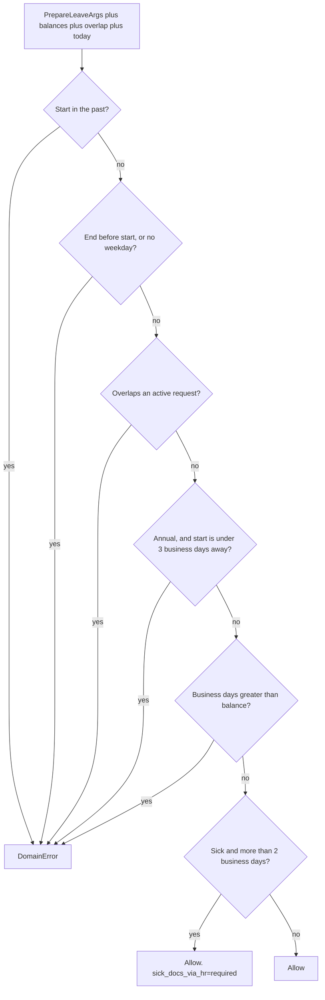

The same checks as a list:

- start date in the past → error
- end before start, or no weekday in the range → error
- overlap with an active request → error (`repository.has_overlap`)
- annual start earlier than 3 business days from today → error (`ANNUAL_LEAVE_NOTICE_BUSINESS_DAYS`)
- business days greater than that leave type’s balance → error
- sick leave of more than 2 business days → still valid, and the summary includes `sick_docs_via_hr=required` (`SICK_LEAVE_DOCS_THRESHOLD_BUSINESS_DAYS`)

Weekends are skipped. Public holidays are not in this calendar.

The prompt tells the model to search policy and explain these errors. If the model skips the search or misreads the chunk, `validate_leave_request` still refuses the write. When the markdown numbers change, these constants must change too. Retrieval does not update them.

Why the sick case still prepares: the policy asks for documents through HR, not for a refusal of the leave itself. The summary flag tells the agent to open a redacted ticket. The chat must not collect a diagnosis.

## 7. Retrieval — seed once, search per question

### Seed — `src/setup_lab.py`

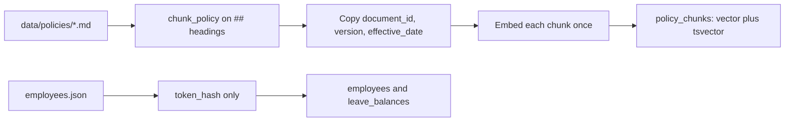

`chunk_policy` splits each `data/policies/*.md` file on `##` headings. Front matter (`document_id`, `title`, `version`, `effective_date`) is copied onto every chunk. Chunk id is `{document_id}:{section-slug}`.

`seed_policy_chunks` embeds each chunk once and stores it in `policy_chunks`, including a `vector` column and a generated `tsvector` for lexical search. `index_version` comes from `POLICY_INDEX_VERSION`.

`seed_identities` inserts employees and balances. Only the token hash is stored.

Run `python -m src.setup_lab` to create tables and seed. `--reset` drops and recreates. Without `--reset`, existing rows stay. Why the default keeps rows: a second seed during a demo must not delete the leave you just confirmed.

### Search — `src/retrieval.py` `RetrievalService.search`

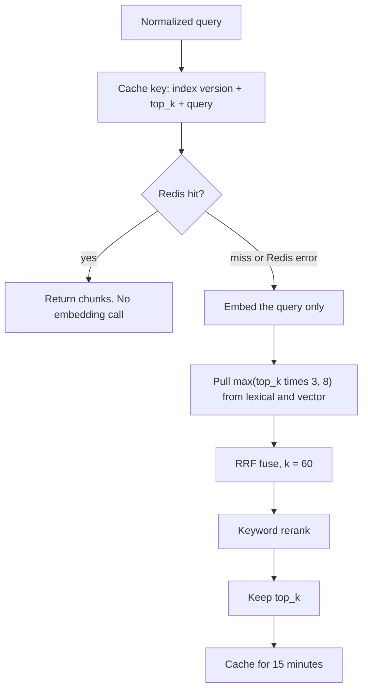

The same search as steps:

1. Cache key = hash of index version + `top_k` + normalized query.
2. Redis hit → return those chunks. No embedding call.
3. Miss → embed the **query** (not the documents), `lexical_search`, `vector_search`, fuse with reciprocal rank fusion (`_rrf_fuse`, k = 60), then `_keyword_rerank`, then cut to `top_k`.
4. Store the ranked list in Redis for `RETRIEVAL_CACHE_TTL_SECONDS` (default 15 minutes).

`ResilientCache` (`src/cache.py`) swallows Redis errors and behaves like a miss. Balances and leave rows never go through Redis.

`top_k` is the model’s argument (schema max 5). A trace can show `top_k: 5` and fewer rows when fewer chunks matched. Why a wider candidate set first: fusion needs more than the final five, or a chunk that was third in one list and absent from the other never gets a chance.

## 8. Confirm in the database — `PostgresRepository.confirm_proposal`

`src/repository.py`. One transaction, `SELECT … FOR UPDATE` on the proposal:

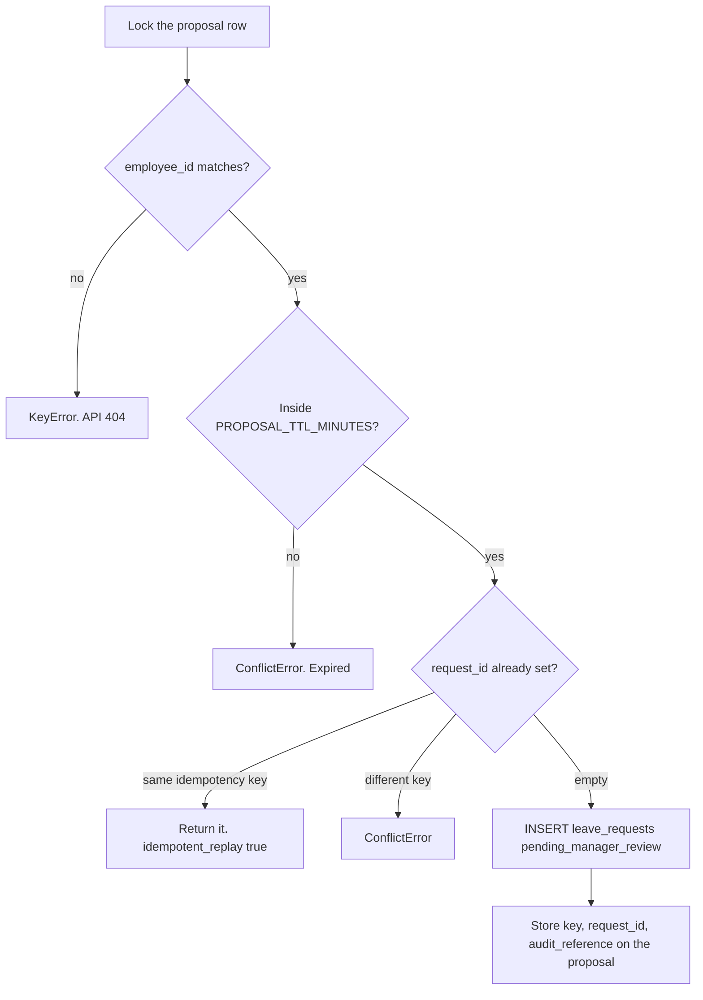

The same transaction as a list:

- Wrong employee or missing row → `KeyError` (API: 404).
- Expired (`PROPOSAL_TTL_MINUTES`, default 15) → `ConflictError`.
- `request_id` already set and the same idempotency key → return that request with `idempotent_replay=true`. No second insert.
- `request_id` set with a different key → conflict.
- Otherwise insert `leave_requests.status = 'pending_manager_review'`, then store the key, `request_id`, and `audit_reference` on the proposal.

`MemoryRepository.confirm_proposal` is the same logic for tests. Why a second implementation: tests must prove the lock rules without Postgres, and the two copies have to stay aligned.

The check constraint on `leave_requests.status` allows `approved` so historical seed rows can exist. This application’s insert always uses `pending_manager_review`.

Why 15 minutes: a proposal is a draft the user confirms in the same sitting. An old proposal must not become a request tomorrow with yesterday’s balance check.

## 9. Tables that matter

Defined in `_schema_sql` inside `src/setup_lab.py`.

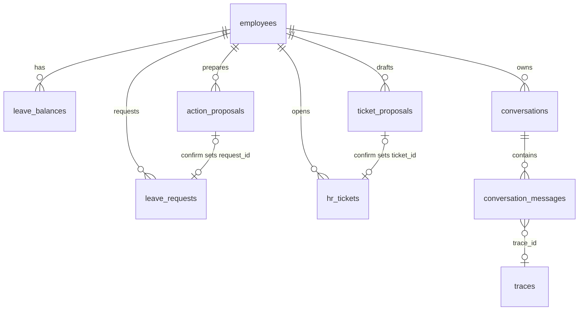

| Table | Written when |
| --- | --- |
| `employees`, `leave_balances` | Seed |
| `policy_chunks` | Seed (embeddings) |
| `conversations`, `conversation_messages` | Each chat turn. Assistant row stores `outcome`, `proposal_id`, `ticket_proposal_id`, `trace_id`. |
| `action_proposals` | Successful prepare. `request_id` stays null until confirm. |
| `leave_requests` | Confirm only |
| `ticket_proposals` / `hr_tickets` | Ticket prepare / ticket confirm |
| `traces` | End of every `run`, redacted JSON |

Why messages and traces are separate: the thread is what the user rereads. The trace is the tool diary, and it must stay redactable without rewriting the sentence in the bubble.

## 10. How a citation is chosen

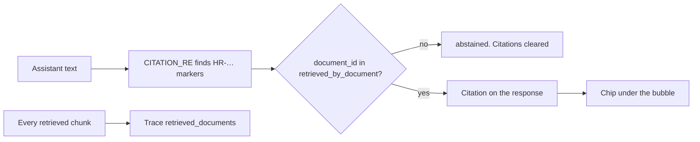

The model is told to write `[HR-LEAVE-001]` style markers. A marker is kept only if that document id was retrieved on **this** run. `[HR-FAKE-999]` fails the gate.

The bubble shows the citation that survived. The inspector list includes chunks the answer did not cite. Several chunks can share one `document_id` (two sections of `HR-LEAVE-001`). Why one row per document for the gate: the marker names a document, not a section. Why the inspector still lists chunks: you need to see which section was actually returned.

## 11. Evaluation — `src/run_evaluation.py`

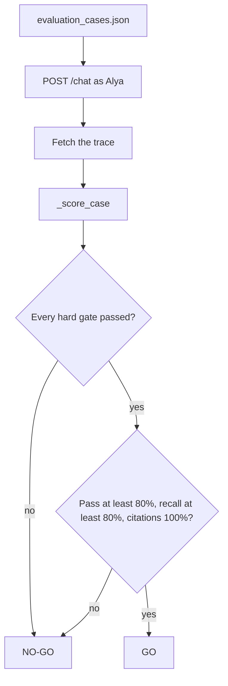

`run()` posts each case, then fetches the trace. `_score_case` fails a case when expected documents are missing, expected tools were not called, the outcome differs, a forbidden string appears (another employee’s token, “diabetes”, `approved`), or a citation is not in the retrieved set.

A fast HTTP 200 with a worse recall is not a release. The last local report is `outputs/evaluation_report.md`.

Overlap (a proposal that hits an existing request) is `tests/test_overlap_regression.py`, not one of the 15 live cases. Why: the rule does not need a model, and a live case would make a database check look like a wording check.

## 12. Where to look when a chat surprises you

| What you saw | Look here |
| --- | --- |
| “Not enough policy evidence” on a short reply like “2 days” or “annual” | `is_leave_request_intent` and `leave_intake_still_open` in `agent.py`. Follow-up is a Python check, not a flag the model sets. If it misses, the turn is treated as ungrounded and abstains. |
| Answer names the other employee but the numbers are yours | `signed_in_balance_answer` after the loop |
| Confirm button added a “confirm” bubble | `confirmFromChat` in `chat-thread.tsx`, then `is_confirm_intent` / `confirm_leave_request` |
| Policy text and the refusal disagree | `domain.py` constants win for writes. Search only explains. |
| Inspector shows more documents than the bubble | Retrieved chunks vs citations that passed `CITATION_RE` |
| Second confirm did not create a second request | `confirm_proposal` replay branch |
| High input tokens on a short question | `SYSTEM_INSTRUCTIONS` + calendar + up to 12 prior messages, repeated for each model turn in the loop. See [ai-guide.md](ai-guide.md). |

Tests that lock these behaviors live under `hr-assistant/tests/`. `tests/test_api.py` and `tests/test_agent_reliability.py` are the fastest way to see the expected outcome without calling OpenAI (`MODEL_MODE=fake`).
