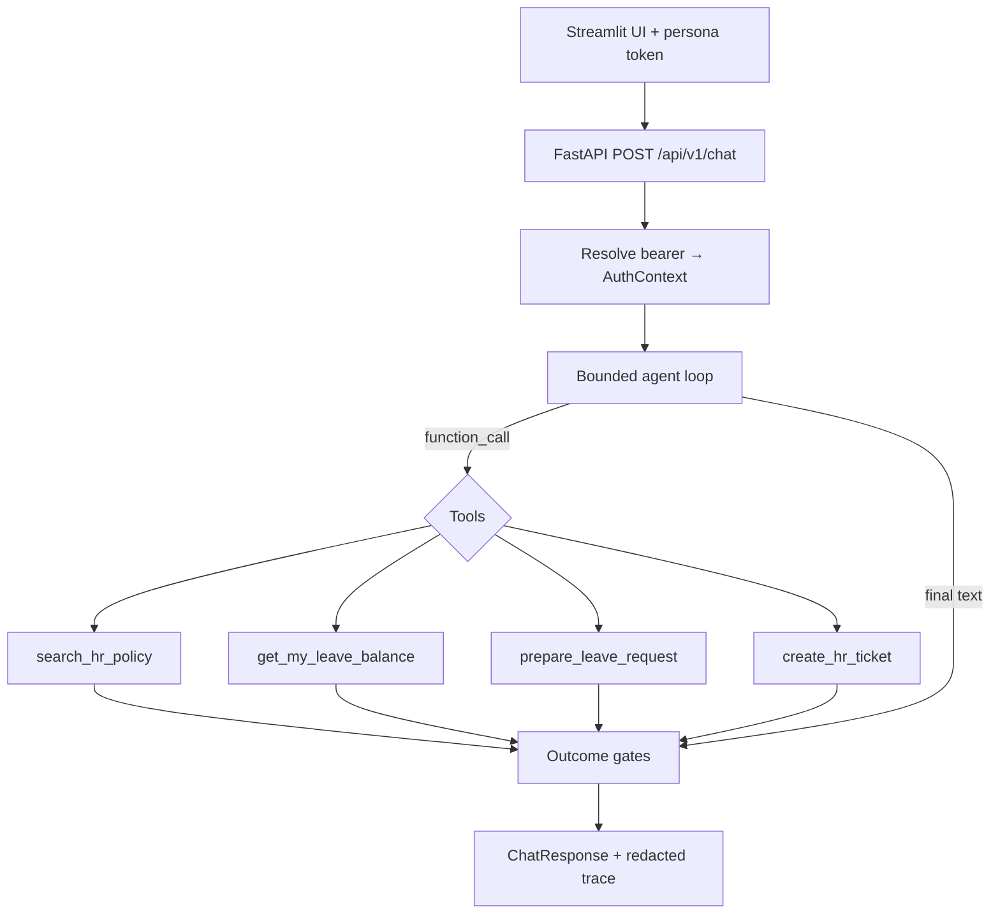
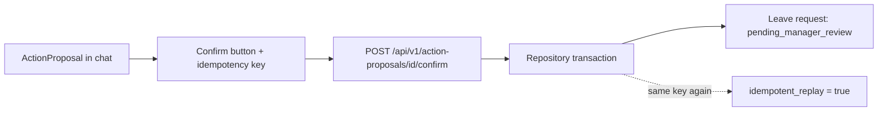
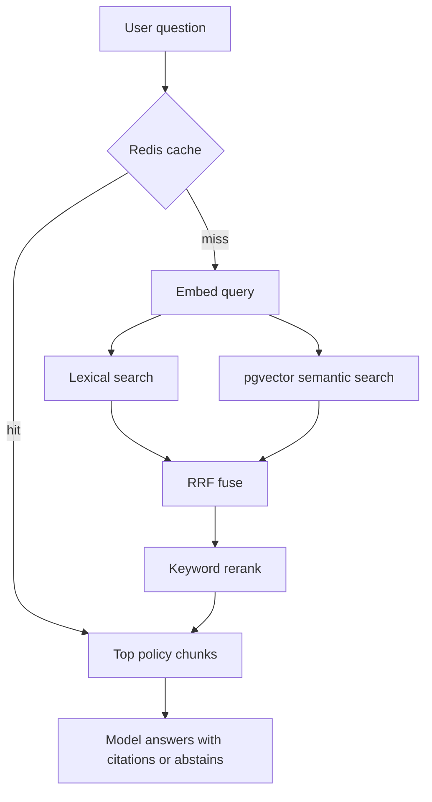
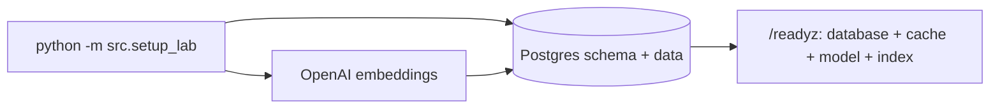

# Project guide — flows and details

Learning-oriented overview of **HR Policy and Leave Assistant**: what the product does, how requests move through the system, and which modules own each concern.

Related docs: [architecture](architecture.md) · [risks](risks.md) · [demo script](demo.md)

---

## 1. One-sentence product

Employees ask about HR policy and leave; the API authenticates them; a bounded agent may search policies, read **their** balance, prepare a leave proposal, or open a ticket; leave becomes `pending_manager_review` only after **confirm**; a human still approves leave.

---

## 2. Hard gates (non-negotiable)

| Gate | Meaning |
| --- | --- |
| No cross-employee access | Balance and leave rows always use the bearer identity |
| No system-approved leave | There is no approve tool; status is never `approved` from this system |
| No side effect before confirm | `prepare_leave_request` only creates a proposal |
| No secrets in repo/image | `.env` stays local; Docker build does not need an API key |
| Runnable evaluation | Live 15-case runner produces a GO/NO-GO report |

---

## 3. Runtime stack

| Piece | Role | Default |
| --- | --- | --- |
| Streamlit (`app.py`) | Demo UI only; talks to HTTP API | `:8501` |
| FastAPI (`src/api.py`) | Auth, chat, confirm, monitoring | `:8000` |
| Agent (`src/agent.py`) | Bounded tool loop + outcome gates | — |
| Tools (`src/tools.py`) | Four tools (no approve) | — |
| Retrieval (`src/retrieval.py`) | Hybrid RAG | — |
| Postgres + pgvector | Employees, balances, requests, policy chunks | Compose `postgres` |
| Redis | Retrieval cache (degrades on failure) | Compose `redis` |
| OpenAI | Embeddings + Responses API (`store=False`) | From `.env` |

```text
Streamlit UI
    │  Bearer demo token
    ▼
FastAPI  ──►  Agent loop  ──►  Tools / RAG
    │                              │
    │                              ▼
    │                         Postgres (+ Redis cache)
    │
    └── Confirm endpoint ──► pending leave row
                      └──► redacted traces / monitoring
```

---

## 4. Visual flows

### 4.1 Chat request (policy, balance, tools)



**Outcome gates (server-side):**

- Citations must match documents retrieved on **this** run → otherwise abstain
- Failed `prepare_leave_request` (e.g. past date) → abstain
- Ungrounded free-form answer (no tools / no citations) → abstain
- Successful ticket → `escalated`
- Successful proposal → `action_proposed` (still no leave row)
- Final answers are passed through `redact()`

### 4.2 Leave confirm (the only leave mutation)



### 4.3 Inside `search_hr_policy` (RAG)



Policies are seeded from `data/policies/` as **versioned chunks** (document id, section, effective date, embedding). Index version is controlled by `POLICY_INDEX_VERSION`.

### 4.4 Seed and readiness



---

## 5. Personas

| Persona | ID | Token | Use for |
| --- | --- | --- | --- |
| Alya | EMP-001 | `token-alya` | Policy Q&A, own balance, leave happy path |
| Bima | EMP-002 | `token-bima` | Other employee; cross-user / IDOR checks |
| Monitoring admin | ADM-001 | `token-admin` | Monitoring tab only — **no leave balances** |

Switching persona in the UI clears chat and confirmation keys (`ui_contract.select_persona`). Identity is always enforced on the server from the bearer token, not from client-supplied employee ids.

---

## 6. API surface

| Method | Path | Purpose |
| --- | --- | --- |
| GET | `/healthz` | Liveness |
| GET | `/readyz` | DB, cache, model, policy index |
| POST | `/api/v1/chat` | Agent turn |
| POST | `/api/v1/action-proposals/{id}/confirm` | Create pending leave (idempotent) |
| GET | `/api/v1/leave-requests/me` | Own leave requests |
| GET | `/api/v1/traces/{trace_id}` | Redacted trace for a run |
| GET | `/api/v1/monitoring/summary` | Aggregate metrics (admin) |
| GET | `/api/v1/monitoring/alerts` | Active alerts (admin) |

UI paths are fixed in `ui_contract.API_PATHS`.

---

## 7. Four tools (no approve)

| Tool | What it does | Side effect? |
| --- | --- | --- |
| `search_hr_policy` | Hybrid retrieval over policy chunks | Read-only (cache write OK) |
| `get_my_leave_balance` | Balances for **authenticated** employee only | Read-only |
| `prepare_leave_request` | Domain-validates and stores a **proposal** | Proposal only |
| `create_hr_ticket` | Opens an HR ticket (summary redacted) | Ticket row |

Domain rules in `src/domain.py` (no model calls): past dates, end before start, overlap, insufficient balance, business-day count.

---

## 8. Module map

| Module | Responsibility |
| --- | --- |
| `src/config.py` | Settings from `.env` (empty optional strings → `None`) |
| `src/contracts.py` | Request/response types, outcomes, proposals |
| `src/domain.py` | Deterministic leave validation |
| `src/security.py` | Token hash, safety id, PII/token redaction |
| `src/cache.py` | Null / Redis / resilient degrade |
| `src/retrieval.py` | Hybrid search, RRF, rerank |
| `src/tools.py` | Strict schemas + identity-bound execution |
| `src/providers.py` | OpenAI live provider + deterministic test fake |
| `src/agent.py` | Tool loop, citations, abstain/escalate gates |
| `src/repository.py` | `MemoryRepository` (tests) + `PostgresRepository` |
| `src/api.py` | FastAPI app and endpoints |
| `src/setup_lab.py` | Schema + seed employees/policies/embeddings |
| `src/run_evaluation.py` | 15-case live evaluation → GO/NO-GO |
| `app.py` | Streamlit client |
| `ui_contract.py` | Persona load/switch + API path contract |
| `data/policies/` | Synthetic HR policy corpus (mostly Indonesian) |
| `data/evaluation_cases.json` | Graded live cases |
| `tests/` | Offline + live markers |
| `Dockerfile` / `docker-compose.yml` | Non-root image; four Compose services |

---

## 9. Language behaviour

| Surface | Language |
| --- | --- |
| Product UI, personas, docs | English |
| Policy corpus + evaluation cases | Mostly Indonesian (contract data) |
| Chat replies | Follow the user’s language (agent instruction) |

English questions work; citations may still quote Indonesian policy excerpts.

---

## 10. Evaluation as release

Evaluation is a **product release gate**, not leave approval.

Release targets (see `src/run_evaluation.py`):

- Hard gates **100%**
- Overall pass ≥ **80%**
- Retrieval recall@3 ≥ **80%**
- Citation validity **100%**
- No system-created `approved` leave

```bash
python -m src.run_evaluation --base-url http://localhost:8000 --token token-alya
```

Reports land in `outputs/` (gitignored).

---

## 11. Suggested learning order

1. **Trust** — [architecture.md](architecture.md) trust table + bearer auth in `api.py`
2. **Domain before model** — `domain.py` + `prepare_leave_request` in `tools.py`
3. **RAG** — `setup_lab` seed → `retrieval.py` → citation block in `agent.py`
4. **Agent loop** — `SYSTEM_INSTRUCTIONS` and outcome gates in `agent.py`
5. **Confirm** — confirm handler in `api.py` + idempotency
6. **Eval** — `evaluation_cases.json` + `run_evaluation.py`
7. **Delivery** — [demo.md](demo.md) Docker sequence

---

## 12. Demo walkthrough (aligned to flows)

1. Alya → policy question → citations (flows 4.1 + 4.3)
2. Alya → leave balance → `get_my_leave_balance` only
3. Alya → future leave range → Confirm → `pending_manager_review` (flow 4.2)
4. Confirm again → idempotent replay
5. Past leave / unknown policy → abstain; medical phrasing → escalate + redact
6. Ask for another employee’s balance → still own identity
7. Monitoring admin → Monitoring tab (not leave balance)

Full timing script: [demo.md](demo.md).
